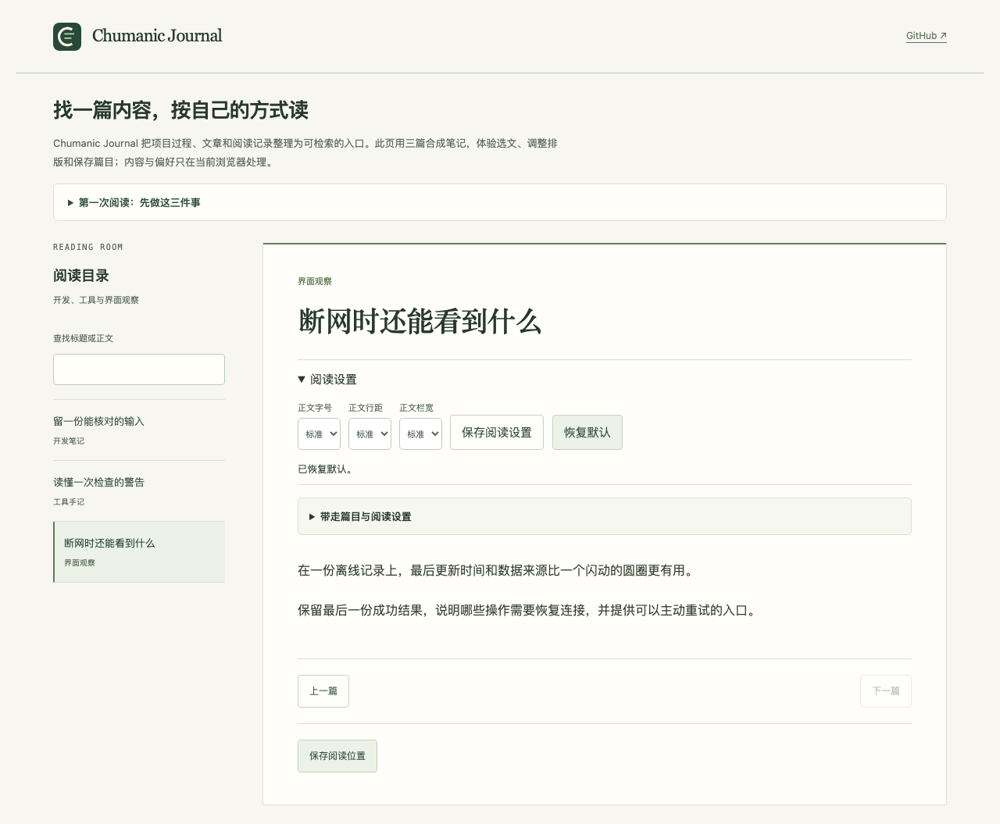

# Chumanic Journal

[](https://github.com/Chumaniac/chumanic-blog-app/actions/workflows/pages.yml) [](LICENSE)

检索文章，点击「保存阅读位置」可让当前浏览器下次回到这篇文章。

**[打开阅读样例 →](https://chumaniac.github.io/chumanic-blog-app/)**

进入后，从目录选择文章，搜索标题或正文，展开「阅读设置」调整排版，再点「保存阅读位置」。样例使用三篇示例短文，保存的是篇目，不是正文行号。

[](https://chumaniac.github.io/chumanic-blog-app/)

_公开短文与阅读交互样例。点击截图开始阅读。_

阅读页的“第一次阅读”可以打开目录搜索、定位排版设置或定位篇目保存。打开引导不会替你保存；阅读样例保存当前篇目，不记录正文行号。

## 快速开始

```sh
git clone https://github.com/Chumaniac/chumanic-blog-app.git
cd chumanic-blog-app
python3 -m http.server 8000 --bind 127.0.0.1 --directory site
```

打开 `http://127.0.0.1:8000/`。样例包含三篇原创短文，支持标题与正文搜索。用 Tab 移动焦点、用 Enter 选择文章。清空搜索会回到先前选中的篇目；刷新时只恢复主动保存的篇目。

展开「阅读设置」可调整正文字号、行距和栏宽。浏览器允许时跨篇记住这些设置；「恢复默认」保留已保存的阅读篇目。

## 常见问题

**需要配置服务吗？** 无需密钥、数据库或环境变量。页面加载后，检索和阅读都在本地完成。

**能登录我的私人订阅吗？** 此仓库只展示阅读交互。私人订阅、管理服务、稿件和部署配置由站点所有者维护。

改动页面后，可在窄屏和桌面测试搜索、空结果与保存位置。许可见 [MIT](LICENSE)。

提交修改前，按[维护与核对说明](CONTRIBUTING.md)检查阅读行为和公开内容。拉取请求只准备静态页面制品，合入主线后才更新在线样例。

## 工作区与窄屏操作

阅读目录在手机上按需展开，选择后聚焦正文；可在当前检索范围内阅读上一篇或下一篇。搜索无结果会显示明确提示，字号、行距、栏宽和手动保存篇目各自保留。

## 带走篇目与排版

展开“带走篇目与阅读设置”，导出当前实际显示篇目的 ID 与字号、行距、栏宽；JSON 不含正文或私人订阅。导入上限 8 KiB，先应用到当前页，核对后可分别保存篇目和阅读设置。导入期间可以取消或继续阅读；切换文章、搜索、修改设置后，晚到的文件不会覆盖当前操作。错误文件不会改写已保存数据。

脚本尚未就绪时仍可阅读第一篇完整样例，目录与保存按钮保持不可用，并提供刷新入口。它不代表离线安装或后台同步；断网后重新打开仍取决于 HTML 是否已缓存。

维护者可用 Node 24 运行 `node --test tests/reading-profile.test.mjs` 核对备份格式。公开阅读端不包含本机编辑提案、CMS、账号或模型接口。
